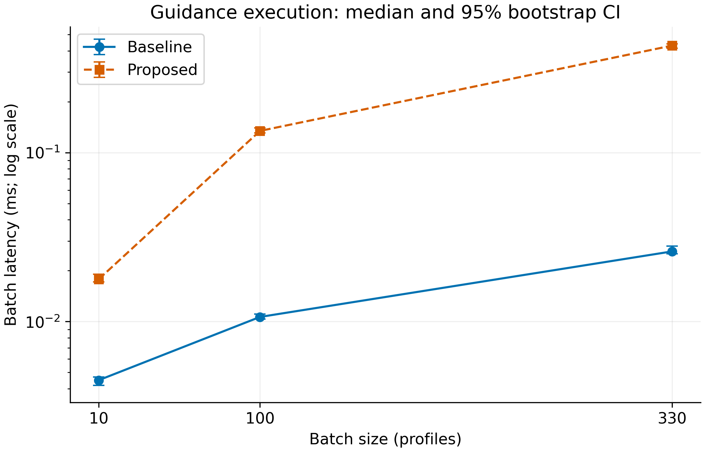
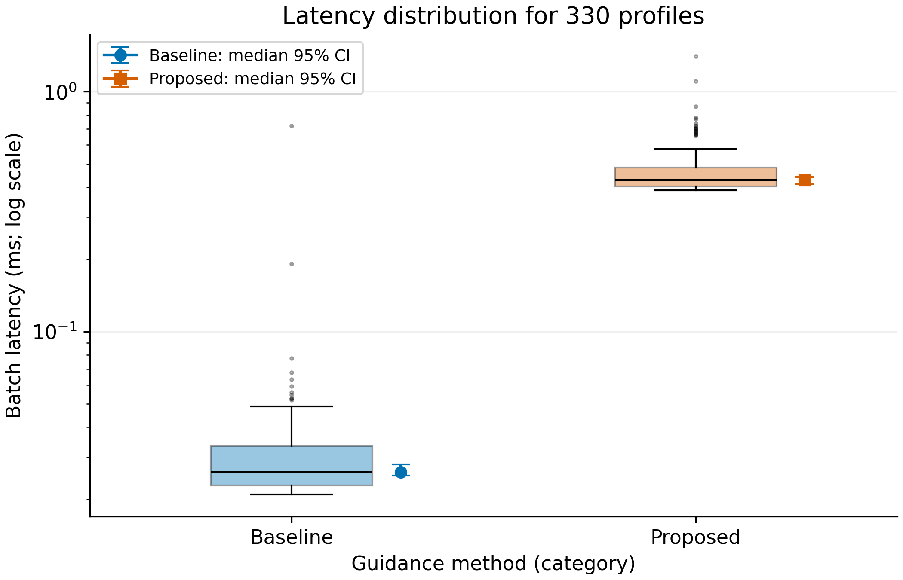

# Why Saving Seems Pointless to Students

**Gumar Nurtore and Kydyralina Akniet — Research Methods, Task 3**

Technical evaluation of a rule-based saving coach prototype. Inputs are synthetic;
recorded timings are real. No human participants or generative AI intervention were tested.

## Research context

The original A/B/C design studies total-price emphasis, installment emphasis and personalized guidance.
The [Task 2 overview](docs/task2_overview.md) and [original protocol](docs/experimental_protocol.md)
are retained. This task asks how much computation the personalized calculator adds to a fixed reminder.
It cannot establish whether an AI assistant changes students' behavior.

## Quickstart

Use Python 3.12 in a virtual environment, from this repository root:

```bash
python -m pip install -r requirements.txt
python run_task3.py
```

If kernel startup is blocked, use `python run_task3.py --in-process`.

This executes the notebook and recreates summaries, figures, this README and the report from the supplied
logs. To collect a new run on your own computer, use `python run_task3.py --measure` instead of the second
command. This replaces the saved measurements; results will change. No GPU or API key is needed.
Conda alternative: `conda env create -f environment.yml`, then `conda activate saving-research-task3`.
For interactive editing, open the notebook in VS Code with the Jupyter extension and the same environment.

## Files

| Path | Purpose |
|---|---|
| data/synthetic/ | 330 profiles, generation manifest and checks |
| data/raw/test_run.jsonl | 1320 recorded batch measurements, including warm-up |
| data/raw/run_metadata.json | Measurement environment, timestamps and hashes |
| data/processed/metrics_summary.csv | Latency statistics and error rates |
| notebooks/01_data_analysis.ipynb | Executed notebook with visible outputs |
| src/task3_benchmark.py | Input adapter, fixed reminder and measurement runner |
| src/mentor_preview.py | Existing Task 2 personalized calculator |
| src/process_data.py, src/visualize.py | Statistics and figure export |
| src/task3_report.py | Report/README generation from saved statistics |
| scripts/generate_dataset.py | Reproduce the synthetic input data |
| reports/task3_report.md | Submission report; review before LMS upload |
| docs/domain_model.md | C4 component diagram and arithmetic definitions |
| docs/task3_protocol.md | Measurement design and limitations |
| docs/questionnaire_ru.md | Extended survey for future piloting |

## Results & Discussion

A batch is a sequential list of profiles, not simultaneous users. Each method/load has 200 measured
runs after 20 warm-ups. CI = 2000-resample percentile bootstrap interval for the median.

| Profiles | Method | Median (p25–p75), ms | 95% CI of median, ms | p95 / p99, ms | Errors |
|---:|---|---|---|---|---:|
| 10 | Baseline | 0.0045 (0.0021–0.0074) | 0.0042–0.0047 | 0.0154 / 0.0237 | 0/200 |
| 10 | Proposed | 0.0178 (0.0157–0.0239) | 0.0171–0.0191 | 0.0332 / 0.0470 | 0/200 |
| 100 | Baseline | 0.0106 (0.0077–0.0164) | 0.0104–0.0111 | 0.0215 / 0.0349 | 0/200 |
| 100 | Proposed | 0.1342 (0.1239–0.1510) | 0.1305–0.1397 | 0.2231 / 0.3748 | 0/200 |
| 330 | Baseline | 0.0260 (0.0229–0.0335) | 0.0251–0.0280 | 0.0519 / 0.0786 | 0/200 |
| 330 | Proposed | 0.4291 (0.4021–0.4835) | 0.4134–0.4402 | 0.7008 / 0.8677 | 0/200 |

At 330 profiles, Baseline took a median of 0.0260 ms per batch and
Proposed took 0.4291 ms. The observed ratio of medians was 16.5.
This is an overhead comparison: Proposed performs personalized calculations and creates a larger output.
It is not a fair comparison of two algorithms solving an identical task, and no speed improvement is claimed.
There were 0 failed batches out of 1200 measured attempts.
The 0% target guardrail is met in this run.
Successful timings alone do not hide failures: the table retains all attempts in the error denominator.






The box shows quartiles and 1.5-IQR whiskers; dots show outliers. Adjacent markers show median CIs.
Vector PDF versions are in the same folder. [Domain model](docs/domain_model.md).

## Interpretation and limitations

Proposed performs more work than Baseline. Timing differences are overhead, not evidence of better
financial decisions. There is one host/session; p99 and CIs are sensitive to noise and dependence.
The [synthetic-data notes](docs/synthetic_data_notes.md) explain invented response coefficients.
Synthetic group differences cannot validate the human study. No savings behavior was observed.

## Checks and provenance

`python -m unittest discover -s tests -v` checks the original pipeline and the Task 3 additions.
The delivered notebook cells were executed from start to finish using IPython in a fresh Python process.
For final verification, use Jupyter Restart & Run All locally before submission. Benchmark measurements were collected on Nurtore's Windows 11 computer. Statistical analysis and visualizations were produced on Akniet's Mac. Benchmark environment details are in data/raw/run_metadata.json. Direct dependency versions are pinned.
The old Task 2 sample still runs with `python -m src.benchmark`.
Generated source and report drafts used ChatGPT assistance; the project team must review and understand
its contributions before submission. Review guidance is in [the Russian guide](docs/TASK3_GUIDE_RU.md).

[MIT license](LICENSE). No private student data is included.
