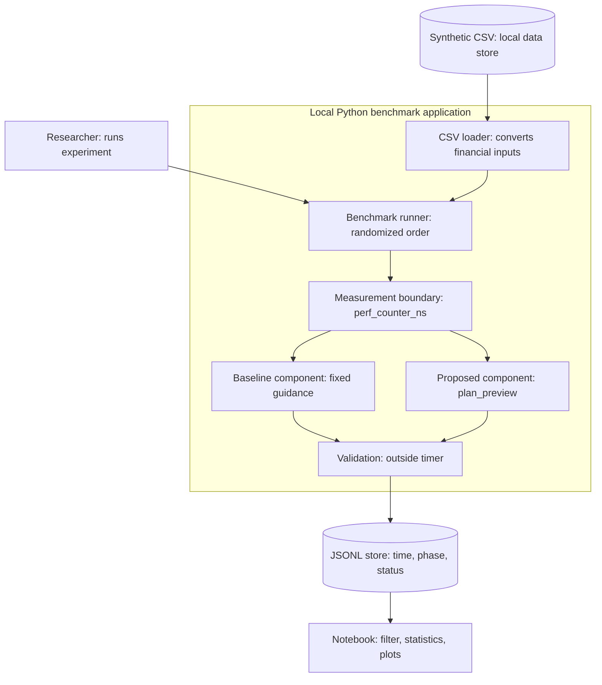

# Domain model: financial guidance prototype

We use the Software Engineering track because the implemented system is a Python prototype, not a trained ML model. This is a C4 component view of its local Python application. Future mobile UI, banks and LLM APIs are outside the implemented boundary.

The timer starts before the batch function and stops after its return (or exception).
CSV reading, randomization, validation, JSON encoding and disk writes are excluded.
The logger stores unsuccessful measurements too. Load means number of profiles in a sequential batch, not concurrent users or requests per second.

## Arithmetic contract

Let I be monthly income, E essential expenses excluding existing installments,
D existing monthly installments, P = 6000 KZT the new payment, and k = 4 months.
Let T be the saving goal and S current savings. All monetary inputs are nonnegative integer KZT.

$$F=I-E-D,\qquad R=\max(0,T-S),\qquad F_{purchase}=F-P.$$

The warning flag is true if $F_{purchase}<0$. The total purchase cost is $kP=24000$ KZT.
If R = 0, the goal is already reached (0 months). Otherwise, without purchase,
$M_0=\lceil R/F\rceil$ for F > 0. If F <= 0, no finite completion time is reported.
With purchase, negative cash after the payment also returns no feasible plan.
If $F-P>0$ and $R\leq k(F-P)$, then $M_1=\lceil R/(F-P)\rceil$.
Otherwise $M_1=k+\lceil (R-k(F-P))/F\rceil$ when F > 0 and F-P >= 0.

The method assumes constant income, no interest, and saving all remaining money.
It is a transparent arithmetic scenario, not a forecast or financial recommendation.
Existing installments are already included in the CSV's monthly_essential_kzt;
the adapter subtracts them before passing E so that D is counted once.
